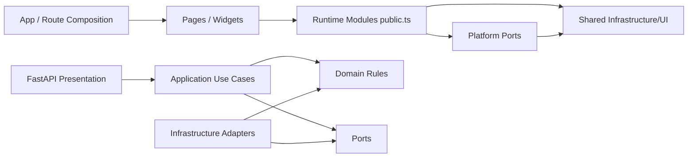

# Memory Anki 架构

> 当前架构地图，也是 `tools/check_architecture.py` 直接消费的门禁资产。完整文档入口见 [docs/README.md](../README.md)；2026-11-04 清理后，本目录只保留门禁依赖的最小集合，其余架构说明以 `AI_PROJECT_CONTEXT.md` 与各模块 `MODULE.md` 为准。前端 `features/` 与 `entities/` 已迁移进 `modules/*`；后端公共导入经由各上下文声明的 `public` / `api` 入口。


本文件是当前架构地图。产品与运行时上下文位于 `AI_PROJECT_CONTEXT.md`；`local_app_home` 下的运行时文件使用三个根目录：`学习数据`、`学科附件`、`日志缓存`（详细路径由 `memory_anki.core.config` 派生）。

## 系统形态

```text
apps/web: app -> pages/widgets -> modules (15, 统一经 public.ts；内部目录形态不完全相同) -> shared/platform/pwa
apps/api: presentation -> application/use cases -> domain + ports <- infrastructure
```

前端运行时模块（`apps/web/src/modules/*`）：`backup city content dashboard exam english english-lookup memory mindmap practice produce quiz search session settings`。旧版 `features/` 与 `entities/` 层已完全迁移进 `modules/*`（实体包位于 `modules/<name>/domain/*-entity` 下）。层级方向由 ESLint（`eslint-plugin-boundaries` 配合 TypeScript resolver）强制；模块 `public.ts` 纪律由 `tools/check_architecture.py` 强制。

本仓库是供两台设备使用的本地优先 Windows 产品。SQLite、文件、备份、PWA 与桌面客户端共用同一个本地后端。跨设备行为必须是确定性的，因为运行时数据在 Git 之外同步。

## 归属

| 能力 | 前端归属 | 后端归属 |
|---|---|---|
| 脑图文档规则 | `modules/content/domain/mindmap-document-entity` | `modules/mindmap_document` |
| 通用脑图渲染 | `shared/ui/mindmap-canvas`（画布本身懒加载 `@xyflow`） | — |
| 脑图编辑运行时 | `modules/content/ui/mindmap-editor` | 聚合专用的编辑器服务 |
| 宫殿聚合 | `modules/content`（`domain/palace-entity`，palace-catalog/palace-edit UI） | `modules/content` |
| 复习排期/执行 | `modules/memory` + `modules/practice/ui/review` | `modules/memory` |
| 复习提醒（Bark 推送、定时投递日志） | `modules/settings`（`ProfileRemindersPage`） | `modules/reminders` |
| AI 运行时选择/调用 | `modules/settings/domain/ai-runtime-entity` | `platform.application.AiRuntimeProvider`；由设置提供适配器 |
| 后台任务 | `shared/background-tasks` | 目标共享任务租约/处理器基础设施 |
| 客户端偏好 | `modules/settings/domain/preferences-entity` | 设置/个人资料偏好端点 |
| 路由元数据（导航/历史/回退） | `shared/routing/routeManifest.ts`（单一来源） | — |
| 反馈运行时（cue → recipe → 声音、触感、CSS jelly、DOM flourish） | `shared/fx`。调用方只使用来自 `@/shared/fx` 的 `cue()`；不使用粒子或 WebGL 效果 | — |
| 学习城市地平线（学习场景底部一条） | `modules/city`（宿主组件、今日岛计划）+ `public/city/horizon.html`（隔离 iframe，Three.js/GSAP 本地化） | `GET /dashboard/city-today`（只读）。见 [city.md](./city.md) |
| 学习进度（`/progress`，层级 / 分布 / 题目覆盖） | `modules/dashboard` | `modules/dashboard`，通过 content/memory/quiz/english 的公共读取能力组合 |
| 成长元数据（XP、等级、任务、印章；仅后端读取投影，无前端模块或页面） | —（无前端归属；UI 未使用 `growth_state`） | `modules/progression`（只读投影） |
| 考期边缘呼吸、卡片悬浮上浮 | `shared/ambient`（纯函数、无数据）；`app/shell/useAmbientTone` 向它提供 exam 数据。只剩考前两周的屏幕边缘呼吸；窗光、时段色调、纸张颗粒已移除 | — |
| 界面声音 | `shared/feedback/uiSounds`（委托监听器，由 `uiSoundEnabled` + `soundEnabled` 控制；在 `.freestyle-stage` 内静音）；合成音色位于 `shared/feedback/mindmap-audio` | — |
| 诊断简报（左上角「录制」） | `shared/debug/session-recorder` 订阅 `shared/api/requestOutcome`；`shared/api` 不得反向导入 recorder。自动采集只保存白名单元数据（固定动作/页面类别、HTTP 方法、有限状态码、失败类别、有界数量），不保存题目、答案、脑图标题或正文、原始错误、完整 URL、业务 ID、请求/响应体；用户手写说明单独保留。见 [session-recorder-privacy.md](./session-recorder-privacy.md) | — |

## 硬性不变量

1. 纯文档/领域模块不导入 React、FastAPI、SQLAlchemy、文件路径或业务聚合。
2. 通用 UI 不包含宫殿、复习、掌握度、分段或其他业务字段；由宿主将其转换为视觉能力。
3. GET/读取投影不修改也不提交业务状态。
4. 序列化器不修复聚合。修复与对账是显式命令或维护任务。
5. 以实体为作用域的异步操作携带 `ownerId` 与 `operationId`；过期的完成、失败、重试与冲突动作会被忽略。
6. 旧版规范化在进程重启与跨设备之间是确定性的。绝不从内存地址、随机值、时间戳或本地路径推导持久化 ID。
7. 跨模块依赖使用公共门面、类型化端口或应用事件。私有仓储与应用内部实现不是共享 API。
8. API 输入使用显式命令/查询模型；兼容信封被隔离并有移除计划。
9. 宫殿聚焦练习已退役：运行时代码不得重建聚焦节点字段、路由、进度种类或 UI 动作。
10. 诊断记录只保存白名单元数据：自动事件不得包含学习内容、自由文本、原始错误、完整 URL、业务 ID 或请求/响应体；旧版（v1）诊断历史在首次加载时删除而不迁移。见 [session-recorder-privacy.md](./session-recorder-privacy.md)。

## 目标依赖图



模块到模块的生产导入必须经由目标模块的 `public.ts`；跨模块组合属于 `pages` 或 `widgets`。后端跨上下文调用只有在上下文映射中登记，并经由目标上下文声明的公共 `api` 入口导入时才被允许。私有的 application、infrastructure 与 presentation 模块永远不是跨上下文 API。

`docs/architecture/context-map.yaml` 是唯一的机器可读架构账本。它盘点真实后端上下文、前端运行时模块、公共依赖边、端口、用例、事件与 `UnitOfWork` 归属。禁止占位式目标模块：只有完整的运行时切片存在之后，模块才会登记。新的依赖边在有意设计并登记之前会被拒绝。

应用事务归属是显式的：presentation 构造 infrastructure 适配器，application 用例依赖 `memory_anki.platform.application.UnitOfWork`，且只有适配器调用具体的 ORM 事务。

后端类型边界在完整的 `memory_anki` 包范围内检查。禁止整模块的 Mypy `ignore_errors` 覆盖；无法避免的无类型第三方库只能在导入处使用范围极窄的错误码忽略。

前端 lint 是零警告契约。`apps/web` 的 lint 脚本以 `--max-warnings 0` 运行 ESLint；未使用的兼容 props 与未解决的 Hook 依赖警告必须在其归属边界修复，而不是压制。

## 迁移顺序

1. **保护正确性：** 归属安全的异步保存、确定性 ID、强制修订检查、脑图迁移的原子交付。
2. **读写分离：** 从 GET 处理器与序列化器中移除提交/对账；引入目录/读取投影。
3. **打破依赖环：** 提取复习内容端口、AI 运行时端口、备份事件与后台任务租约。
4. **为边界加类型：** Pydantic 请求/响应模型、运行时前端解码器、更窄的 mypy 例外、按目录收紧 TypeScript。
5. **控制性能：** 每次复习查询只加载一次策略、分页目录投影、批量 ORM 加载、单遍脑图投影/布局。
6. **退役兼容层：** 只有在调用方完成迁移且回归测试存在之后，才移除旧版门面与架构例外。

## 感官运行时

- `shared/fx` —— cue → recipe 反馈运行时（声音、触感、CSS jelly、DOM flourish；按 owner 限定播放范围）。
- `shared/theme` —— 单一 `study` 主题包（仅 `motion` 与 `themeColor`）。
- `shared/feedback/mindmap-audio` —— 程序化合成音色、音色池选择、`AudioContext` 生命周期/iOS 解锁、静音范围、按场景的音量闸门。

## 校验

- 快速迭代：`python tools/quality_gate.py`
- 完整交接：`python tools/quality_gate.py --full`（后端测试、前端测试/构建与 Playwright 冒烟）
- Playwright 是密封的：spec 从 `apps/web/e2e/fixtures.ts` 导入 `test`/`expect`（除非 spec 自行路由，否则每个 `/api` 调用都返回 503），Service Worker 被阻止，且 `MEMORY_ANKI_E2E=1` 会移除 vite 的 `/api` 代理，使 e2e 永远无法写入在线的 8012 服务。`check_e2e_hermetic` 强制这一点。
- 运行时/启动敏感变更后的 Windows 启动器冒烟：`python tools/quality_gate.py --launchers`（真正运行 `start-all.bat --smoke-test` 与 `start-all.bat --desktop`，验证 API/Electron 就绪，然后恢复共享 PWA 服务）
- 脑图架构细节：`docs/architecture/mindmap.md`
- 随心沉浸式信息流：`docs/architecture/freestyle-immersive-feed.md`
- 测验前端边界：`docs/architecture/quiz-frontend-boundary.md`
- 宫殿测验边界：`docs/architecture/palace-quiz-boundary.md`
- 实时学习在场（PWA/桌面镜像）：`docs/architecture/live-study-presence.md`
- 诊断记录隐私边界：`docs/architecture/session-recorder-privacy.md`
- 训练证据边界：`docs/architecture/unified-training-evidence.md`
- 单一架构账本：`docs/architecture/context-map.yaml`
- 临时文件级例外：`docs/architecture/boundary-exceptions.json`
- 复习排期（20 分钟复查 → 第 2 天隔夜，之后受控 FSRS；三条护栏；睡前复习只记本轮）：`docs/复习排期设计.md`
- 退役阶梯与 FSRS 的只读历史对比：`python tools/review_fsrs_shadow.py`
- 密封 Playwright E2E 规则、AI 运行时、反馈、主题、读取模型、考试、备份、术语等其余说明：`AI_PROJECT_CONTEXT.md` 与对应模块 `MODULE.md`（旧单篇架构文档已于 2026-11-04 删除）。
## 变更标识边界

请求变更 ID 由无框架依赖的 `platform.application.MutationIdentity` 契约表示。Presentation 从请求头提取标识，并使用平台 SQLAlchemy 响应存储适配器。宫殿不再导入已退役的 Persistence 上下文；变更响应参与用例已有的 `UnitOfWork` 事务。

`platform.application.MutationReplay`（经由 `open_mutation_replay`）是该边界的共享重放查找句柄。它从请求头推导标识，将其绑定到调用方构造的 `MutationResponseStore`，并暴露 `existing()` / `save(payload)`。它只执行重放查找与存储：不提交（每个调用方保留自己的事务归属，因为各路由在何时提交以及用例是否拥有事务上各不相同），也不塑造响应（重放会原样返回已持久化的载荷）。它无框架依赖——依赖 `MutationResponseStore` 协议，而不依赖 SQLAlchemy 或 FastAPI——因此 presentation 构造适配器，而该辅助器保持不导入 infrastructure。

当请求还可能在请求体中携带操作 ID 时，调用方会覆盖 `MutationReplay.identity`；当重放载荷必须属于特定实体时，调用方会自行校验。`memory/presentation/router.py`（`patch_unit_schedule`）两者都做，因此它保留自己的查找，而不是不加检查地使用句柄存储的载荷。

## 学习会话变更命令

五个幂等的学习会话 HTTP 写入由 `sessions.application.study_session_commands` 组合。每个命令都要求旧版持久化原语在不提交的情况下 flush，通过平台适配器存储变更响应，并通过 `UnitOfWork` 提交一次。因此 sessions 不依赖已退役的 Persistence 上下文。

英语课程 HTTP 包装器归 `apps/web/src/modules/english` 所有（通过其 `public.ts`）；页面不得重建一套并行的 english API 层。听力课程通过本地字幕导入（`POST /english/import`）构建：后端解析 SRT/VTT/ASS，把破碎的 cue 片段合并成句子，按时间线对齐可选的中文音轨，并存储规范化 token。此路径不运行 ASR 或翻译 AI。听写阶段（`ui/english-dictation`）负责整词判定、逐字母着色、键盘快捷键、三种布局与可拖拽模糊遮罩；其纯状态模型位于 `domain/english-dictation/model.ts`。播放默认单句模式，可切换为连续模式（`F3`）：单句模式在每个 cue 结束时暂停，连续模式跨 cue 跟随播放头而不暂停。边界检查使用轻量 30 ms 定时器而不是逐帧回调，视频播放时遮罩切换为不透明填充（暂停时恢复模糊），`/english/courses/{id}/media` 实现 HTTP 字节范围，使播放器无需先下载整个文件即可跳转到 cue 时间戳。

前端 AI 场景/模型选择与逐次运行覆盖归 `modules/settings/domain/ai-runtime-entity` 所有；业务模块通过 `modules/settings/public` 消费它，且不得重建 `ai-config` 功能。

## 路由元数据单一来源

`apps/web/src/shared/routing/routeManifest.ts` 是 路由 → 导航区 / 页面历史区 / 历史键 / 回退目标 映射的单一来源。`app/shell/navSections.ts` 的匹配器、`shared/page-history/navigationSection.ts`、`shared/page-history/pageHistoryRoute.ts` 以及路由器的 404 回退都从它派生；JSX `<Routes>` 表仍手工维护，并由 `src/shared/routing/routeManifest.test.ts` 对账。先在清单中登记新路由。

## 已登记的后继重构（尚未完成）

每个条目仍必须处于其门禁阈值之上。`tools/check_architecture.py` 运行 `check_oversized_baseline_is_current`，因此已完成（或其文件已删除）的后继项会一直让门禁失败，直到其 `BASELINE_OVERSIZED_FILES` 条目被移除——该清单不能悄悄继续豁免一个已不再需要豁免的路径。

- 通过把相关 API 下沉到模块公共入口之后，解决 `modules→widgets` 边界例外（practice/quiz 导入 `mindmap-review-flow` / `palace-memory-lookup` API）。
- 拆分 `shared/ui/mindmap-canvas` 的超大文件（`layout.ts`、`useMindMapCanvasState.ts`；`NodeCard.tsx` 749 行，未超过 750 行门禁）。
- 从 `NodeBoundQuizDialog` 与 `FreestyleScopeQuizDialog` 中提取共享的题目元信息行（统计 / 类型 / 变体控件 / 评分 / 标记）；在题目变体工作流之后，两者暂时超过 750 行门禁。
- 拆分 `shared/components/ui/dialog.tsx` 以及随心模型测试装置 `freestyleProgressSegments.test.ts` / `roundCompletion.test.ts`；在拆分之前登记为临时质量门禁例外。
- 拆分本轮轮次计划与评分工作撑大的三个随心文件：`FreestyleRoundSheet.tsx`（拆成弹层子组件）、`freestyleProgressSegments.ts`（模型与摘要分离）、`ratingSaveStore.ts`（类型/纯函数与 store 分离）。目前登记为临时门禁例外；下一次随心重构应删掉这三条例外。
- 可选：重命名导航区键 `'knowledge'`→`'create'`、`'review'`→`'insights'`（需要 pageHistoryStore 键迁移）。

已完成并因此不再列出：`PalaceEditorPage.tsx`（当前 738 行）、`GlobalTimerProvider*` / `TimerAutomationDialog` / `useTimedSession*` 会话宿主，以及 `PalaceQuizGenerationPanel.tsx`（已删除）。`PalaceMindMapWorkspace.tsx`（728 行）与 `PalaceChapterBindingDialog.tsx` 随宫殿编辑器的目录树重写一并删除：编辑器左栏现在是 `modules/content/ui/palace-edit/components/PalaceDirectoryTree.tsx`（学科 → 章节 → 宫殿，点击就地切换宫殿，把宫殿拖到章节上即可重新绑定），`PalaceMetaPanel` / `PalaceAttachmentPanel` / `usePalaceMetaController` 随绑定表单一起移除。

## 刻意保留的手写代码

`memory/application/unit_fsrs_adapter.py`、`core/time.py`、`quiz/application/manual_text_quiz_parser.py` 与 LLM 客户端的重试处理都承载着现成库无法表达的产品规则，没有替换计划。旧的评估记录已随 2026-11-04 清理删除；结论仍适用。（`unit_scheduler.py` 本身现在是 FSRS 适配器之上的薄包装；它过去拥有的产品规则位于适配器中，并由 `test_unit_fsrs_adapter.py` / `test_unit_scheduler_rules.py` 固定。）


## 运行时拥有的工作流

集中式架构替换已经从两个易出错的学习闭环切片开始。新的业务代码位于 `apps/web/src/modules` 下，浏览器副作用位于 `apps/web/src/platform` 下，XState 被限制在 `application/workflows` 中。

- `freestyle`：`canCompleteRound` 是无框架依赖的领域守卫；`FreestyleTrainingMachine` 拒绝由滚动驱动的完成。沉浸式信息流配置、跳过/刷新规则与队列标识位于 `modules/practice` 下；后端队列构建只组合公共的 `content`、`memory`、`quiz` 与 `english` 能力。只有一个沉浸式路由（`/freestyle`）；原 `/freestyle-2` 已由迁移 0072 合并进来，现在会重定向。复习书架复习打开 `/palaces/<id>/review` 并复用随心信息流而不进入 `/freestyle`。已退役的独立 `/review` 页面未登记。
- `mindmap`：`MindMapPresentationMachine` 拥有嵌入式/全屏切换；`PresentationPort` 拥有原生全屏、视口锁定、Escape 处理与布局调度。
- 跨模块导入必须使用目标模块的 `public.ts`。
- 运行时端口、用例、事件与前端模块归属内嵌在 `docs/architecture/context-map.yaml` 中；不维护并行的架构目录。
- `apps/web/src/modules` 下的运行时模块是生产归属图；不要把已迁移的逻辑作为领域代码移回 pages。禁止空的面向未来的模块脚手架。

- 统一训练证据边界：`docs/architecture/unified-training-evidence.md`
- 诊断记录隐私边界：`docs/architecture/session-recorder-privacy.md`

已移除的应用内 AI 与 PDF 功能的历史说明已随 2026-11-04 清理删除（代码已删除，数据库表保留）。英语保留本地字幕听力听写（`/english/listening`）、完形阅读（`/english/cloze`）与单词查询。手动 JSON 导入（“文字转脑图”）仍然保留。

## 复习结算边界

- 正式复习结算只能通过 `memory_anki.modules.practice.api` 通知临时标记生命周期；memory 上下文不得导入 practice 的应用内部实现。
